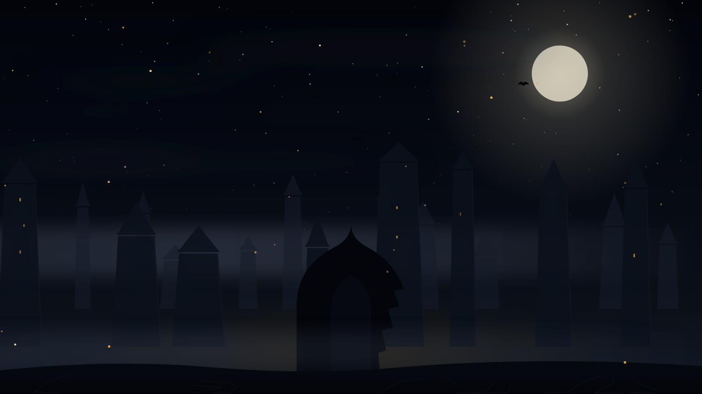
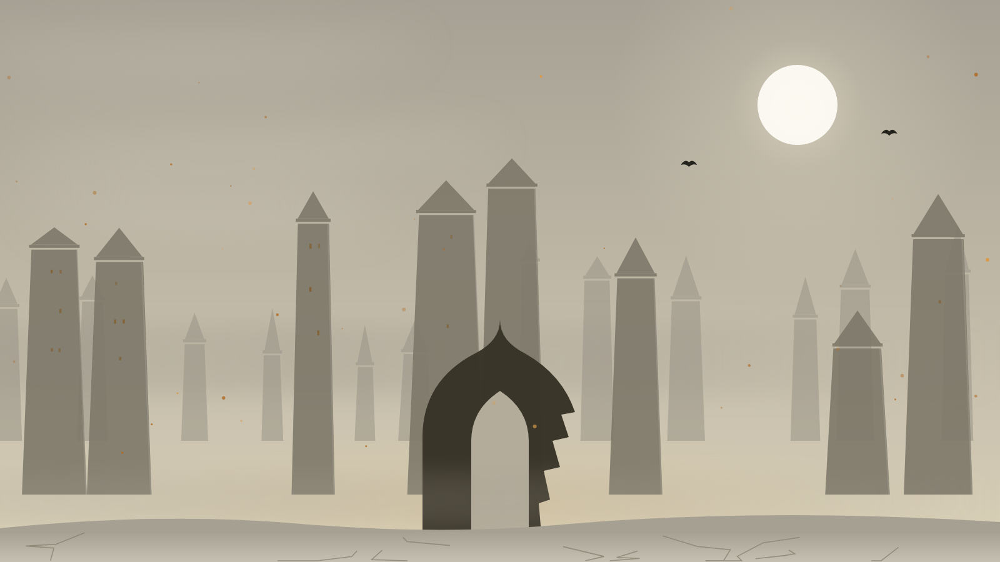

# Veil of Ulgard

The **Veil of Ulgard** theme for [DSH Desktop](https://www.deepseek.com/harness/),
in a dark-fantasy key: a night over a dead city, ash on the wind, and a lantern
carried by a truth-seeker.



## What is on screen

The night of Ulgard lies under the whole interface, and the panels become glass
you can see it through.

| Layer | What it does |
| --- | --- |
| **Sky** | From black at the zenith to a warm glow at the horizon: something burns beyond the hill |
| **Veiled moon** | A disc in a halo, its light breathing on an eleven-second cycle |
| **Cirrus streaks** | Thin clouds in the left sky: they dim the light without arguing with the moon |
| **Towers in three planes** | Far ones pale and windowless, middle ones with warm windows, near ones dark |
| **The gate** | A pointed arch with a broken right pier: an entrance to the city, not one more tower |
| **Mist** | Three bands at different depths, drifting opposite ways at different speeds |
| **Ravens** | Seven silhouettes, wing-beat and a glide across the whole sky |
| **Ash** | Rises slowly and fades; caught in the lantern light, it flares up |
| **Ground** | Dark at the lower edge, with cracks running out from the gate |

## The lantern

The theme's main departure from a static background is **the seeker's living
lantern**.

- The light follows the pointer and drives the darkness back around it.
- The light is drawn additively (`lighter`), so overlapping pools only grow
  brighter and the lantern leaves no dirty seams.
- **Ash that enters the light flares up and drifts toward the lantern** — exactly
  what the theme was made for.
- Pointer leaves the window — the lantern fades out smoothly rather than snapping.
- Screen edges sink into darkness; the depth of that darkness is the **Gloom**
  slider.

## Settings

The theme adds a panel under **Settings → General**:

| Slider | What it changes |
| --- | --- |
| **Veil** | Turns the theme on. Off restores the shell's own background |
| **Density** | How many towers, ravens and ash motes fill the scene (0.2–2) |
| **Gloom** | How deeply the screen edges sink (0–1) |
| **Lantern** | Radius and brightness of the light (0–1) |

Settings are stored in `localStorage` under `dsh-veil-of-ulgard.prefs`.

## Schemes

The theme carries **both schemes** and follows the
Light/Dark/System switch:

| | Dark | Light |
| --- | --- | --- |
| What it is | The night of Ulgard | A grey morning, the veil grown thin |
| Sky | Black with a warm glow | Ashen grey, warm near the ground |
| Stars | Present, dimming toward the horizon | None |
| Towers | Nearly black silhouettes | Grey stone with warm windows |
| Panel glass | `rgba(5,7,12,0.50)` | `rgba(222,214,196,0.52)` |



## Install

From this repository:

```bash
dsh plugin --profile web add github:Sovero/dsh_plugins#path:dsh-veil-of-ulgard
```

From a local path (development):

```bash
dsh plugin --profile web add /absolute/path/to/dsh-veil-of-ulgard
```

The package carries the bundle configuration, so installing the plugin also
places it into the profile's `dsh.profile.bundles`. Restart DSH Desktop
afterwards: the host composes the profile config at startup.

Remove with:

```bash
dsh plugin --profile web remove dsh-veil-of-ulgard
```

## Files

| File | Purpose |
| --- | --- |
| `dsh.plugin.json` | Plugin manifest: `main`, `client.main`, `engines` |
| `lib/index.js` | Host half: it exists so the package is recognised as loaded |
| `lib/client.js` | Browser half: scene, lantern, tokens, settings panel |
| `cordis.patch.yml` | Bundle patch layer: the `insert` row that mounts the plugin |
| `tools/smoke.mjs` | Client-half check without a browser |

## Development

Browserless check — it stubs the environment and runs the code as is:

```bash
node tools/smoke.mjs lib/client.js scene.svg
DSH_VEIL_SCHEME=light node tools/smoke.mjs lib/client.js scene-light.svg
```

The smoke test catches exactly the failures that leave the background silently
unpainted: the bundle never registered, the layer was not created, the scene is
not a whole SVG document, `xlink:` lacks an `xmlns:xlink` declaration, the glass
layer is missing a light/dark pair, the schemes are identical, the lantern's live
canvas was not created.

## Technical decisions

They are written down here because each one cost debugging.

- **A layer, not a document background.** The shell paints an opaque background on
  `#root`, and an image on `html, body` ends up behind it — the plugin works and
  the night is invisible. A layer at `z-index: -1` inside the isolated `body`
  stacking context sits between the page background and the app content.
- **The plugin owns `#root` transparency.** While the shell's theme owned it, the
  night was visible; a shell update made `#root` opaque and the night vanished
  with the plugin alive. `!important` beats any non-important shell style.
- **Only `background-color` is removed.** Not `background` as a whole: otherwise
  the panels' glass gradients, the very point of the theme, would disappear.
- **The glass layer is applied once.** `overrideTokens` publishes `theme/change`
  itself, so a listener would call it again and the glass would run into infinite
  recursion (`RangeError: Maximum call stack size exceeded`). The layer form
  works: both schemes are set per token and the theme picks the right one.
- **`xmlns:xlink` must be declared.** The scene travels in a data URL and is
  parsed as XML, where an unknown prefix is a fatal error. Without the
  declaration the whole document fails to render.
- **Slots are found by their own effect, not by `apply`.** `ctx.get("slots")` in
  `apply` made the whole plugin reactive to the service appearing — hence "the
  night appeared and then vanished": the context went stale, effects were torn
  down, `apply` ran again.
- **`exports.inject = ['theme', 'slots', 'timer']`.** The fiber waits for the
  services, and only then does `ctx.get` return a live service. Without `timer`,
  `ctx.timeout` throws "cannot get property \"timer\" without inject" right inside
  the `theme/change` dispatch and cuts it off before the layout subscriber.
- **The host half must not touch services.** An exception out of `apply` takes the
  fiber down together with the browser half — the theme disappears entirely while
  the log shows a single vendor line. A silent plugin is more useful.

## License

MIT — see [LICENSE](LICENSE).
